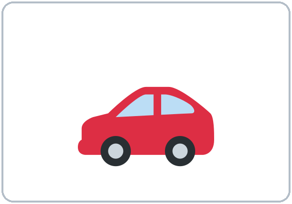
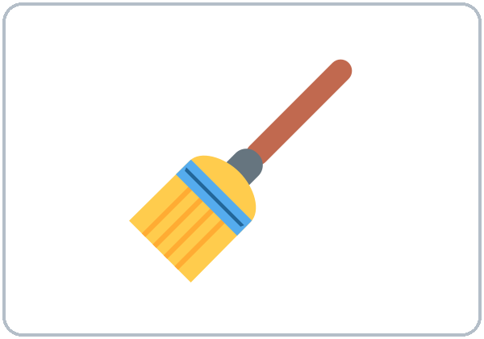

<!-- mode: guide -->
# Level 1 · Week 15: Final Exam: Teacher Packet

**Final Exam · Lessons 1–13 (focus on 8–13)** · Level 1 Adult ESL

**Contents**

- Step-by-step directions (for any teacher or volunteer)
- Clock-time plan
- Speaking interview and rubric
- Listening script
- Answer key and scoring guide
- Teacher notes
- Papers to copy: Speaking Interview Card (teacher), Speaking Task Cards, Speaking Score Sheet (teacher), Can-Do Self-Check, one-page Answer Key (teacher)

<!-- mode: teacher -->
## How to Use This Packet

- **The test for learners is a separate file:** `Level1_Final_Student_Test.pdf` (no answers). Print 1 per learner + 3 extra.
- **This packet** is for you: directions, the listening script, the answer key, and the speaking papers.
- **Audio:** `audio/L1_Final_listening.mp3` (about 1:17). The conversation is in the file **once**. Press play again for the next listen.
- **No Spanish needed.** The Spanish lines on the test are for learners.

## Week 15: Final Exam: Step by Step

### What the test has

| Part | What learners do | Points | Time |
|---|---|---|---|
| A. Listening | Listen to a short conversation. Circle a picture or a word (7 items). Write one number (1 item). | 8 | 15 min (6:10–6:25) |
| B. Words | Look at a picture. Circle the word. | 6 | 20 min for B + C (6:25–6:45) |
| C. Grammar | Circle the correct word (2 choices). | 15 | (with B) |
| D. Form | Copy the information from a practice card onto a job application. | 6 | 10 min (7:00–7:10) |
| **Written total** | | **35** | **45 min** |
| Speaking interview | Pairs (or one-on-one) with the teacher. Scored with the rubric, not added to the written total. | 3–9 | 3 min per pair |

*Covers Lessons 1–13 (focus on 8–13). Every item uses only words and grammar from these lessons, and the same task types as the lessons (circle, check, write one number, copy onto a form, pair questions).*

### Before class (20 minutes)

1. Print the student test (1 per learner + 3). Print this packet's Speaking Task Cards (1 per pair), the Score Sheet, and the Self-Check (1 per learner).
2. Put `L1_Final_listening.mp3` on a phone. Connect a small speaker. Play the first seconds to check the volume.
3. Set 2 chairs and 1 chair for you in a quiet corner (for the speaking interviews).
4. Have pencils and a clock or timer.

:::step Step 1 · 6:00–6:10 · Warm-up + first interviews · 10 min
- **Say:** "Tonight is the test. Listening, then words and grammar, then a break, then a form. Don't worry. I read everything with you."
- **Pairs** ask and answer the questions on the Speaking Interview Card (write 4 of them on the board).
- **You:** call 2–3 pairs to the quiet corner for their speaking interview (3 minutes per pair).
:::

:::step Step 2 · 6:10–6:25 · Listening test (Part A) · 15 min · NEVER SKIP
- Hand out the test. Learners write their name.
- **Read every item aloud** and point to the pictures: "Number 1. Where does it hurt?…" Learners only look; they don't write yet.
- **Say:** "Circle **one** answer. Number 3: write the number."
- **Play 1:** learners listen only. **Play 2:** learners circle and write. **Play 3:** learners check. Wait 30 seconds between plays.
- Learners who can't read yet: read the choices aloud and let them point; you circle for them.
:::

:::step Step 3 · 6:25–6:45 · Words and Grammar (Parts B and C) · 20 min · NEVER SKIP
- **Part B:** say "Look at the picture. Circle the word." Read both words for each picture aloud.
- **Part C:** read each sentence aloud with "blank" for the missing word, then read the two words: "Number 1. *Blank* you from Mexico? **Are? Is?**" Learners circle. About 1 minute per item.
- Do the first item of each part together on the board as an example (a different sentence, not a test item).
:::

:::step Break · 6:45–7:00 · 15 min
- Collect nothing. Learners keep their test face down.
:::

:::step Step 4 · 7:00–7:10 · Form (Part D) + interviews · 10 min · NEVER SKIP
- **Say:** "Look at the card. Write the information on the job application." Point to the first line on the card and on the form.
- Learners work alone. They may copy letters one by one; that is OK.
- **You:** start the remaining speaking interviews in the quiet corner.
:::

:::step If time · 7:10–7:30 · Interviews, then the Self-Check
- **① Finish all interviews.** Learners who are waiting do the Can-Do Self-Check, then practice the Task Cards with a partner.
- **② Collect** the tests and the self-checks. Say "Thank you! Great work!"
- **③ Go over the listening (5 min, optional):** play the audio once more and say the answers.
:::

### Clock-time plan

| Time | Step | Min | Grouping | If running behind |
|---|---|---|---|---|
| 6:00–6:10 | Warm-up (pair questions) + first speaking interviews | 10 | Pairs | Shorten the warm-up |
| 6:10–6:25 | **Part A: Listening** (play 2–3 times) | 15 | Individuals | **Never skip**; 2 plays are OK |
| 6:25–6:45 | **Parts B + C: Words and Grammar** | 20 | Individuals | **Never skip**; slow readers finish Part C after the break |
| 6:45–7:00 | BREAK | 15 | | |
| 7:00–7:10 | **Part D: Form** + speaking interviews | 10 | Individuals | **Never skip** |
| 7:10–7:30 | Finish interviews; Can-Do Self-Check; go over the listening | 20 | | The self-check can go home |

> **Written test time:** 15 + 20 + 10 = **45 minutes**. Interviews happen during the warm-up and after the break, while learners work alone.

### Speaking interview (3 minutes per pair)

:::box How to do it
- **Pairs** come to the quiet corner (or one learner, if there is an odd number; you are the partner).
- **How many:** 15 learners ≈ 8 pairs ≈ 24 minutes: about 3 pairs at 6:00–6:10 and 5 pairs at 7:00–7:30. 7–8 learners ≈ 4 pairs ≈ 12 minutes.
- **Part 1 (1 minute):** ask each learner **2 questions** from the Speaking Interview Card. Use different questions for each partner.
- **Part 2 (2 minutes):** give the pair a Task Card: **Mini job interview: Can you…?** Learner A asks; Learner B answers. Then switch.
- **Score right away** on the Score Sheet: 3 areas, 1–3 points each (total 3–9). Write one thing the learner did well.
- **Be kind:** smile, repeat a question once, point to the picture. Don't correct during the interview.
- **Target grammar for this interview:** be questions and short answers; *Can you…? Yes, I can. / No, I can't.*, *I can + verb*.
:::

**Speaking rubric (same 1–3 scale as Level 2, in beginner words):**

| Score | Communication | Target grammar | Pronunciation and fluency |
|---|---|---|---|
| 3 | Answers every question; asks the partner questions | Uses the lesson phrases correctly most of the time | Easy to understand; few long stops |
| 2 | Answers most questions; needs a little help (a repeat, a gesture) | Uses the phrases with mistakes, but the meaning is clear | Mostly easy to understand; some stops |
| 1 | One-word answers or no answer, even with help | Few correct phrases, or mistakes hide the meaning | Hard to understand |

*A one-word answer that is correct (for example, "Guatemala.") is fine for Communication 2. Short answers like "Yes, I do." count as correct target grammar.*

---
### Listening script: `L1_Final_listening.mp3` (about 1:17; the conversation is in the file once, so press play again for each listen)

> **Audio:** play from a phone + small speaker. No speaker? Read the script slowly with a second adult (not a learner). Say numbers as words: *May twelfth; nine thirty.*

> **Narrator:** This is the final exam listening. Kim and Carlos are at English class. It's the break. Listen.
> **Carlos:** Kim, do you want a taco? The restaurant is across from the school.
> **Kim:** No, thanks. I don't feel well. I'm sick.
> **Carlos:** Oh, no! What's wrong?
> **Kim:** It hurts here. My ear.
> **Carlos:** Do you need a doctor?
> **Kim:** Yes. I have an appointment on Friday.
> **Carlos:** On Friday? What's the date?
> **Kim:** It's May twelfth, at nine thirty in the morning.
> **Carlos:** Where is the clinic?
> **Kim:** It's on Pine Street, next to the bank.
> **Carlos:** Can you drive there?
> **Kim:** No, I can't. I can't drive. But there's a bus stop near the clinic.
> **Carlos:** OK. It's rainy today. Take your jacket!
> **Kim:** Thanks, Carlos. You're a good friend.
> **Carlos:** Do you want juice? I have juice.
> **Kim:** Yes, please. I like juice. Thank you!
> **Narrator:** That's the end of the listening.

### Answer key

- *Part A, Listening:* 1 **ear** (choice 2 of 3); 2 **Friday** (choice 2 of 3); 3 **12**; 4 **9:30** (choice 2 of 3); 5 **bank** (choice 1 of 3); 6 **No, she can't.**; 7 **rainy** (choice 2 of 3); 8 **juice** (choice 2 of 3).
- *Part B, Words:* 1 **fish**; 2 **birthday**; 3 **bed**; 4 **pharmacy**; 5 **foot**; 6 **swim**.
- *Part C, Grammar:* 1 **do**; 2 **don't**; 3 **want**; 4 **in**; 5 **on**; 6 **It's**; 7 **There is**; 8 **There are**; 9 **is**; 10 **next**; 11 **Turn**; 12 **not**; 13 **can**; 14 **speak**; 15 **are**.
- *Part D, Form:* Name **Carlos Vega**; Address **35 Oak Street**; Phone number **555-0157**; Date of birth (month/day/year) **07/14/1990**; Days ✓ **Mon, Wed, Fri** (no other days); Skills ✓ **cook and drive** (no other skills).

### Where the answers are in the audio

| # | Answer | The learner hears | Lesson |
|---|---|---|---|
| 1 | ear | "It hurts here. My ear." | 12 |
| 2 | Friday | "I have an appointment on Friday." | 9 |
| 3 | 12 | "It's May twelfth" | 9 |
| 4 | 9:30 | "at nine thirty in the morning" | 9 |
| 5 | bank | "next to the bank" | 11 |
| 6 | No, she can't. | "No, I can't. I can't drive." | 13 |
| 7 | rainy | "It's rainy today." | 9 |
| 8 | juice | "Yes, please. I like juice." | 8 |

### Scoring guide

- **1 point per item.** Part A /8 + Part B /6 + Part C /15 + Part D /6 = **/35**.
- **Listening item 3** (write): the number alone is enough (*12*, *12th*, or *May 12*).
- **Circle items:** one clear circle (or a check, a line, or pointing that you saw) = 1 point. Two answers circled = 0.
- **Part D:** 1 point per line. Copying mistakes of one letter or one number are OK if the word is clear (*Rivrside* = 1 point). Capital or small letters both OK. Days = 1 point only if Mon, Wed, Fri are checked and no other day; Skills = 1 point only if cook and drive are checked and nothing else.
- **Suggested levels (written test):** **Meets** 27–35 · **Almost** 18–26 · **Not yet** 0–17. (Same percentages as the Level 2 exams.)
- **Speaking:** **Meets** = 2 or more in all three rubric areas.
- **Ready for Level 2 (proposed in the Level 1 scope and sequence; the program confirms it):** attended at least 9 of the 13 lessons, took the final, scored 2 or more in all three speaking areas, and got at least 4 of 6 on Part D (no more than 1–2 errors). Learners who are not ready still graduate in Week 16 and are invited to repeat Level 1 or join Level 2 with a study buddy.

### Teacher notes

- **Read everything aloud.** This is a test of English listening and words, not of reading speed. Reading items aloud is part of the test, not extra help.
- **Learners who can't read or write yet:** they point; you circle for them and write "oral" at the top. For Part D, they copy as much as they can; give 1 point for each line with the right first letters or numbers.
- **Extra time is fine.** Slow readers can finish Part C after the break.
- **Absent learners:** give the test next week at 7:10 (play the audio for them with earbuds, 2–3 times). The interview needs a teacher.
- **Privacy:** the form uses an invented practice card. Never ask for a learner's real address, phone number, or immigration information.
- **Return the papers next week** with one strength and one goal for each learner. Week 16 is graduation: each learner gives a 30–60 second "All About Me" talk.

---
<!-- mode: teacher -->
## Week 15: Final Exam · Speaking Interview Card (Teacher)

### Part 1 · Each learner (1 minute)

*Ask each learner 2 questions. Use different questions for each partner.* These are the same 6 baseline questions as Weeks 1–3, so you can see how much each learner has grown.

1. What's your name?
2. How do you spell it?
3. Where are you from?
4. What's your phone number? (a practice number is OK)
5. Do you have kids?
6. What do you do?

### Part 2 · Pair task (2 minutes): Mini job interview: Can you…?

- Learner A: You are the manager. Point and ask: *Can you drive? Can you cook? Can you work on Saturday?*
- Learner B: You want the job. Answer: *Yes, I can. / No, I can't.* Say one more: *I can…*
- Switch. The other partner is the manager.

### Rubric

| Score | Communication | Target grammar | Pronunciation and fluency |
|---|---|---|---|
| 3 | Answers every question; asks the partner questions | Uses the lesson phrases correctly most of the time | Easy to understand; few long stops |
| 2 | Answers most questions; needs a little help | Mistakes, but the meaning is clear | Mostly easy to understand; some stops |
| 1 | One-word answers or no answer, even with help | Few correct phrases, or mistakes hide the meaning | Hard to understand |

---
<!-- mode: student -->
## Week 15: Final Exam · Speaking Task Card (cut apart: 1 per pair)

### Learner A: You are the manager. Point and ask: *Can you drive? Can you cook? Can you work on Saturday?*

*Español: Eres el gerente. Señala y pregunta: ¿Puedes…?*

My language: ______________________________________________

### Learner B: You want the job. Answer: *Yes, I can. / No, I can't.* Say one more: *I can…*

*Español: Quieres el trabajo. Contesta: Sí, puedo. / No, no puedo.*

My language: ______________________________________________

### Switch. The other partner is the manager.

*Español: Cambien. Tu compañero es el gerente.*

My language: ______________________________________________

| | | | |
|---|---|---|---|
|  drive |  cook |  clean |  use a computer |

---
<!-- mode: teacher -->
## Week 15: Final Exam · Speaking Score Sheet (Teacher)

Teacher: ______________________   Date: ______________

| Learner | Comm. (1–3) | Grammar (1–3) | Pron. (1–3) | Total (/9) | One thing done well |
|---|---|---|---|---|---|
|   | | | | | |
|   | | | | | |
|   | | | | | |
|   | | | | | |
|   | | | | | |
|   | | | | | |
|   | | | | | |
|   | | | | | |
|   | | | | | |
|   | | | | | |

*Comm. = Communication · Grammar = Target grammar · Pron. = Pronunciation and fluency. Meets = 2 or more in all three areas. Use a second sheet for more learners.*

---
<!-- mode: student -->
## Week 15: Final Exam · Can-Do Self-Check

Name: ______________________________     Date: ________________

### Listen to the teacher. Check ✓ one box for each line.

*Español: Escucha al profesor. Marca ✓ una casilla en cada línea.*

My language: ______________________________________________

| I can… | Yes | A little | Not yet |
|---|---|---|---|
| I can order food and say what I like. *(Lesson 8)* | ☐ | ☐ | ☐ |
| I can say a date and understand an appointment. *(Lesson 9)* | ☐ | ☐ | ☐ |
| I can say what is in a home. *(Lesson 10)* | ☐ | ☐ | ☐ |
| I can ask where a place is and follow directions. *(Lesson 11)* | ☐ | ☐ | ☐ |
| I can say that I am sick and ask for help. *(Lesson 12)* | ☐ | ☐ | ☐ |
| I can say what I can and can't do at work. *(Lesson 13)* | ☐ | ☐ | ☐ |
| I can talk about me: name, country, family, job. *(Lesson 1)* | ☐ | ☐ | ☐ |

### My goal for Level 2 (or for next time): write or draw one thing.

*Español: Mi meta para el Nivel 2 (o para la próxima vez): escribe o dibuja una cosa.*

My language: ______________________________________________

______________________________________________________________

______________________________________________________________

---
<!-- mode: teacher -->
## Week 15: Final Exam · Answer Key (Teacher)

### Part A · Listening

| # | Answer | # | Answer |
|---|---|---|---|
| 1 | ear | 5 | bank |
| 2 | Friday | 6 | No, she can't. |
| 3 | 12 | 7 | rainy |
| 4 | 9:30 | 8 | juice |

### Part B · Words

| # | Answer | # | Answer | # | Answer |
|---|---|---|---|---|---|
| 1 | fish | 2 | birthday | 3 | bed |
| 4 | pharmacy | 5 | foot | 6 | swim |

### Part C · Grammar

| # | Answer | # | Answer | # | Answer |
|---|---|---|---|---|---|
| 1 | do | 6 | It's | 11 | Turn |
| 2 | don't | 7 | There is | 12 | not |
| 3 | want | 8 | There are | 13 | can |
| 4 | in | 9 | is | 14 | speak |
| 5 | on | 10 | next | 15 | are |

### Part D · Form

Name: **Carlos Vega** · Address: **35 Oak Street** · Phone number: **555-0157** · Date of birth (month/day/year): **07/14/1990** · Days: **✓ Mon, Wed, Fri** (only these) · Skills: **✓ cook, drive** (only these)

*Total: A /8 + B /6 + C /15 + D /6 = /35. Meets 27–35 · Almost 18–26 · Not yet 0–17. The listening script is in this packet ("Listening script").*

<!-- mode: guide -->
### License and Credits

© 2026 the authors. The authors license these materials under CC BY-NC-SA 4.0 (https://creativecommons.org/licenses/by-nc-sa/4.0/). Program names and logos are not covered by this license.

Pictures: Twemoji graphics by Twitter, Inc. and other contributors (https://github.com/jdecked/twemoji), licensed under CC BY 4.0 (https://creativecommons.org/licenses/by/4.0/). The graphics were resized and combined; the clock faces, price tags, and practice cards are original drawings made in code. The file-by-file list is in `images/CREDITS.md`. All names, phone numbers, addresses, and prices are invented.

Listening audio: synthetic voices made with Chatterbox TTS (Resemble AI, MIT License), copied from short reference clips made with Kokoro-82M (Apache 2.0). No recordings of real people were used. Each file carries an inaudible Perth watermark that marks it as AI-generated.

These materials are provided as-is for educational use, without warranty of any kind.
