<!-- mode: student -->
## Week 15: Final Exam · Listening

Name: ______________________________     Date: ________________

### A. Listen. Circle the answer. For number 3, write the number.

*Español: Escucha. Encierra la respuesta. Para el número 3, escribe el número.*

My language: ______________________________________________

*Kim and Carlos are at English class. It's the break.*

| | | | |
|---|---|---|---|
| **1.** Where does it hurt? |  eye | 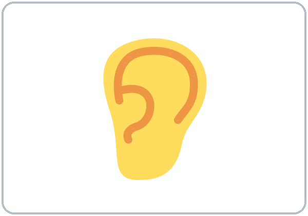 ear | 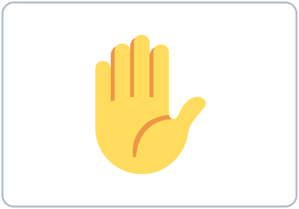 hand |
| **2.** Kim's appointment is on | ^^Thursday | ^^Friday | ^^Saturday |
| **3.** What is the date? Write the number. | ^^May ______ | | |
| **4.** The time is | 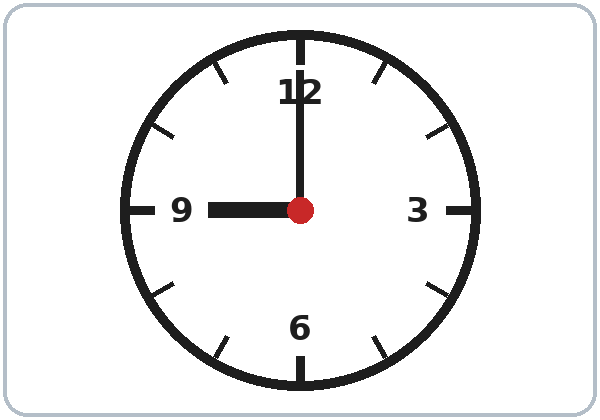 9:00 | 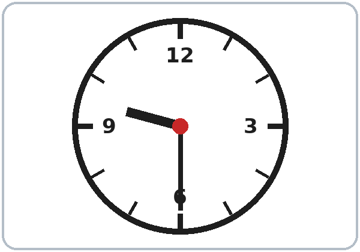 9:30 | 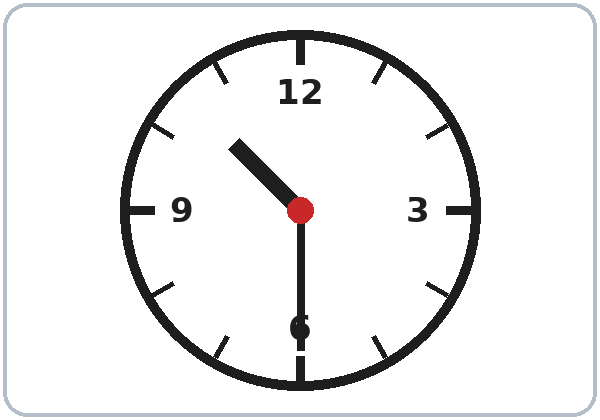 10:30 |
| **5.** The clinic is next to the |  bank | 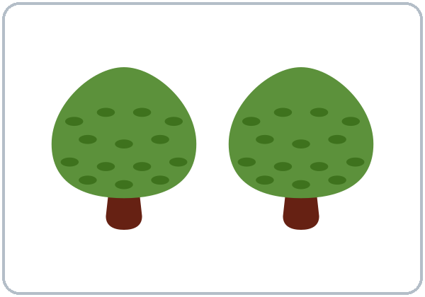 park |  school |
| **6.** Can Kim drive? |  drive | ^^Yes, she can. | ^^No, she can't. |
| **7.** The weather today is | 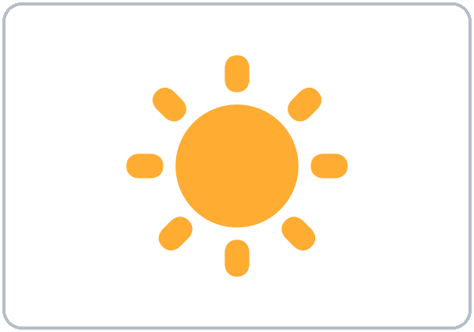 sunny | 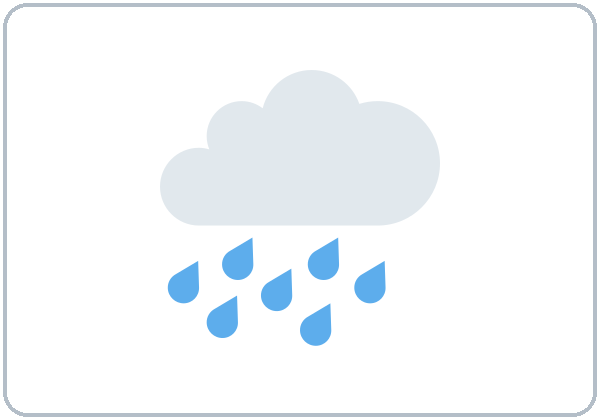 rainy |  hot |
| **8.** Kim wants | 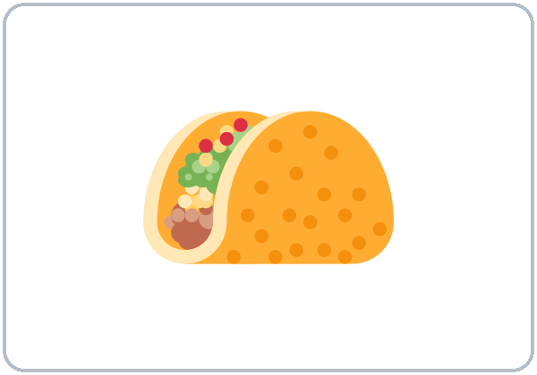 a taco | 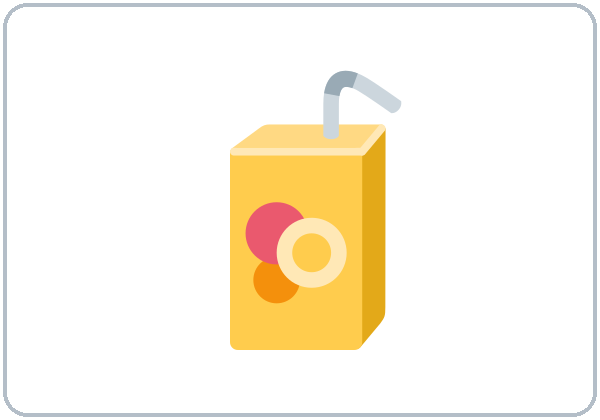 juice |  pizza |

### B. Look at the picture. Circle the word.

*Español: Mira el dibujo. Encierra la palabra.*

My language: ______________________________________________

| | | |
|---|---|---|
| 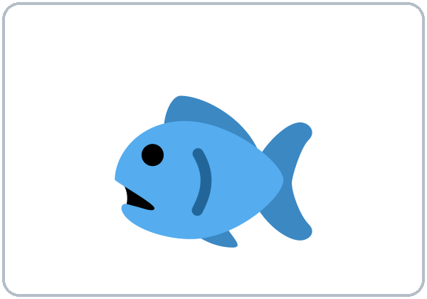 **1.** ^^meat ^^fish | 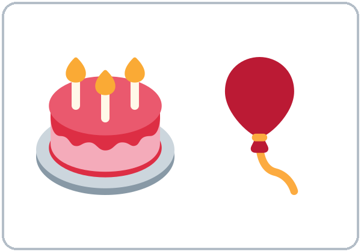 **2.** ^^birthday ^^appointment | 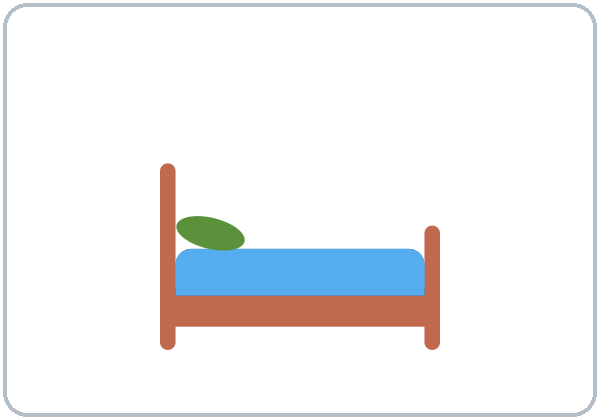 **3.** ^^bed ^^sofa |
| 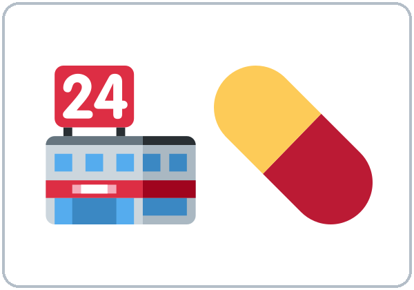 **4.** ^^bank ^^pharmacy | 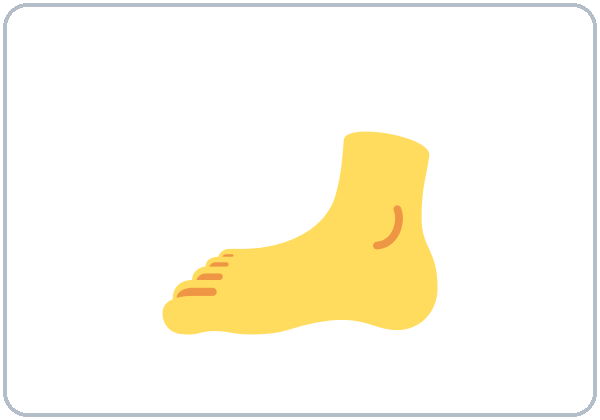 **5.** ^^foot ^^hand | 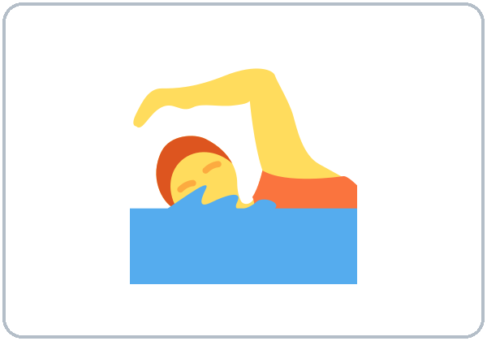 **6.** ^^drive ^^swim |

<!-- pagebreak -->

### C. Circle the correct word.

*Español: Encierra la palabra correcta.*

My language: ______________________________________________

1. Do you like fish? Yes, I ____.        ( **do**   /   **am** )

2. I ____ like coffee.        ( **don't**   /   **no** )

3. I ____ a taco and a soda, please.        ( **want**   /   **wants** )

4. My birthday is ____ May.        ( **in**   /   **at** )

5. My appointment is ____ Tuesday.        ( **on**   /   **in** )

6. How's the weather? ____ cold.        ( **It's**   /   **Is** )

7. ____ a kitchen.        ( **There is**   /   **There are** )

8. ____ two bedrooms.        ( **There is**   /   **There are** )

9. Is there a sofa? Yes, there ____.        ( **is**   /   **are** )

10. The pharmacy is ____ to the bank.        ( **next**   /   **across** )

11. ____ left. Then go straight.        ( **Turn**   /   **Turns** )

12. Are you OK? No, I'm ____. I'm sick.        ( **not**   /   **no** )

13. Can you drive? Yes, I ____.        ( **can**   /   **do** )

14. I can ____ English.        ( **speak**   /   **to speak** )

15. How much ____ these shoes?        ( **is**   /   **are** )

<!-- pagebreak -->

## Week 15: Final Exam · Form

### D. Look at the practice card. Write the information on the job application. Check ✓ the days and the skills.

*Español: Mira la tarjeta de práctica. Escribe la información en la solicitud. Marca ✓ los días y las habilidades.*

My language: ______________________________________________

| |
|---|
| 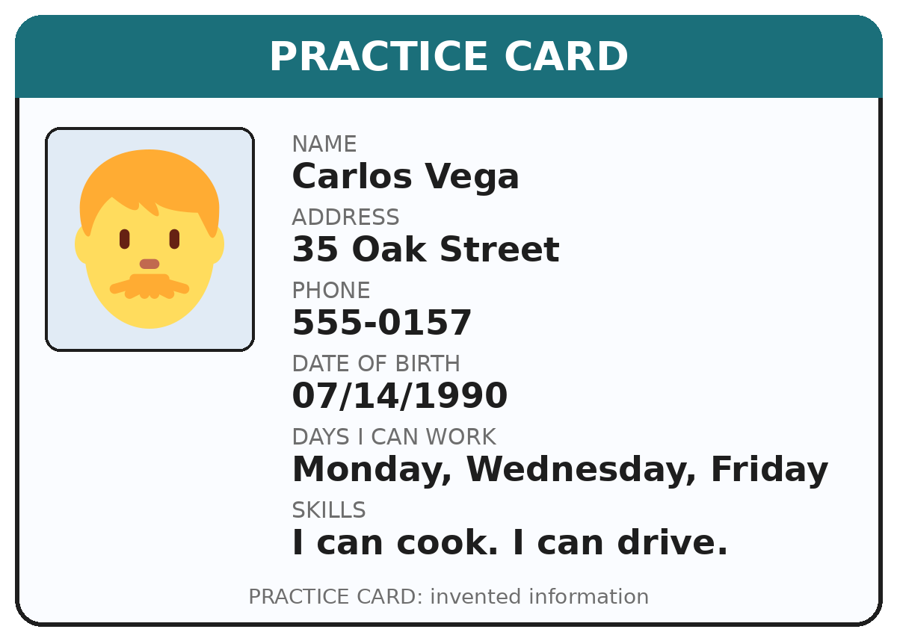 |

| JOB APPLICATION | (write) |
|---|---|
| **Name** |   |
| **Address** |   |
| **Phone number** |   |
| **Date of birth (month/day/year)** |   |
| **Days you can work** (check ✓) | ☐ Mon   ☐ Tue   ☐ Wed   ☐ Thu   ☐ Fri   ☐ Sat   ☐ Sun |
| **Skills** (check ✓) | ☐ cook   ☐ drive   ☐ clean   ☐ use a computer |

**Score:** A ____ /8   B ____ /6   C ____ /15   D ____ /6   **Total ____ /35**
