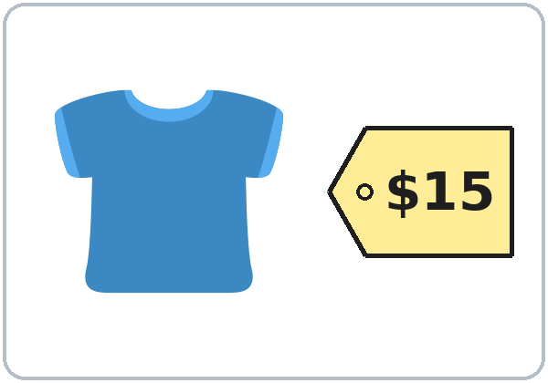
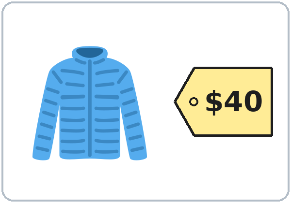
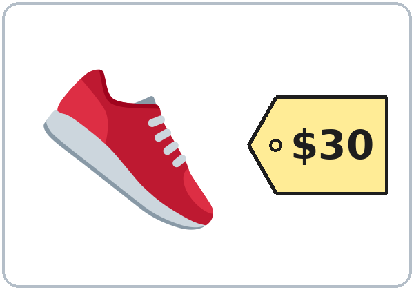
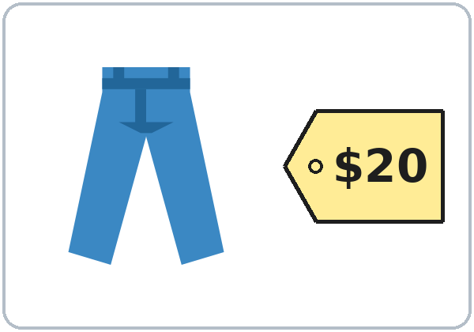

<!-- mode: guide -->
# Level 1 · Week 8: Midterm: Teacher Packet

**Midterm Exam · Lessons 1–7** · Level 1 Adult ESL

**Contents**

- Step-by-step directions (for any teacher or volunteer)
- Clock-time plan
- Speaking interview and rubric
- Listening script
- Answer key and scoring guide
- Teacher notes
- Papers to copy: Speaking Interview Card (teacher), Speaking Task Cards, Speaking Score Sheet (teacher), Can-Do Self-Check, one-page Answer Key (teacher)

<!-- mode: teacher -->
## How to Use This Packet

- **The test for learners is a separate file:** `Level1_Midterm_Student_Test.pdf` (no answers). Print 1 per learner + 3 extra.
- **This packet** is for you: directions, the listening script, the answer key, and the speaking papers.
- **Audio:** `audio/L1_Midterm_listening.mp3` (about 1:23). The conversation is in the file **once**. Press play again for the next listen.
- **No Spanish needed.** The Spanish lines on the test are for learners.

## Week 8: Midterm: Step by Step

### What the test has

| Part | What learners do | Points | Time |
|---|---|---|---|
| A. Listening | Listen to a short conversation. Circle a picture or a word (7 items). Write one number (1 item). | 8 | 15 min (6:10–6:25) |
| B. Words | Look at a picture. Circle the word. | 6 | 20 min for B + C (6:25–6:45) |
| C. Grammar | Circle the correct word (2 choices). | 12 | (with B) |
| D. Form | Copy the information from a practice card onto a form. | 6 | 10 min (7:00–7:10) |
| **Written total** | | **32** | **45 min** |
| Speaking interview | Pairs (or one-on-one) with the teacher. Scored with the rubric, not added to the written total. | 3–9 | 3 min per pair |

*Covers Lessons 1–7. Every item uses only words and grammar from these lessons, and the same task types as the lessons (circle, check, write one number, copy onto a form, pair questions).*

### Before class (20 minutes)

1. Print the student test (1 per learner + 3). Print this packet's Speaking Task Cards (1 per pair), the Score Sheet, and the Self-Check (1 per learner).
2. Put `L1_Midterm_listening.mp3` on a phone. Connect a small speaker. Play the first seconds to check the volume.
3. Set 2 chairs and 1 chair for you in a quiet corner (for the speaking interviews).
4. Have pencils and a clock or timer.

:::step Step 1 · 6:00–6:10 · Warm-up + first interviews · 10 min
- **Say:** "Tonight is the test. Listening, then words and grammar, then a break, then a form. Don't worry. I read everything with you."
- **Pairs** ask and answer the questions on the Speaking Interview Card (write 4 of them on the board).
- **You:** call 2–3 pairs to the quiet corner for their speaking interview (3 minutes per pair).
:::

:::step Step 2 · 6:10–6:25 · Listening test (Part A) · 15 min · NEVER SKIP
- Hand out the test. Learners write their name.
- **Read every item aloud** and point to the pictures: "Number 1. Marco's last name is…" Learners only look; they don't write yet.
- **Say:** "Circle **one** answer. Number 8: write the number."
- **Play 1:** learners listen only. **Play 2:** learners circle and write. **Play 3:** learners check. Wait 30 seconds between plays.
- Learners who can't read yet: read the choices aloud and let them point; you circle for them.
:::

:::step Step 3 · 6:25–6:45 · Words and Grammar (Parts B and C) · 20 min · NEVER SKIP
- **Part B:** say "Look at the picture. Circle the word." Read both words for each picture aloud.
- **Part C:** read each sentence aloud with "blank" for the missing word, then read the two words: "Number 1. *Blank* you from Mexico? **Are? Is?**" Learners circle. About 1 minute per item.
- Do the first item of each part together on the board as an example (a different sentence, not a test item).
:::

:::step Break · 6:45–7:00 · 15 min
- Collect nothing. Learners keep their test face down.
:::

:::step Step 4 · 7:00–7:10 · Form (Part D) + interviews · 10 min · NEVER SKIP
- **Say:** "Look at the card. Write the information on the form." Point to the first line on the card and on the form.
- Learners work alone. They may copy letters one by one; that is OK.
- **You:** start the remaining speaking interviews in the quiet corner.
:::

:::step If time · 7:10–7:30 · Interviews, then the Self-Check
- **① Finish all interviews.** Learners who are waiting do the Can-Do Self-Check, then practice the Task Cards with a partner.
- **② Collect** the tests and the self-checks. Say "Thank you! Great work!"
- **③ Go over the listening (5 min, optional):** play the audio once more and say the answers.
:::

### Clock-time plan

| Time | Step | Min | Grouping | If running behind |
|---|---|---|---|---|
| 6:00–6:10 | Warm-up (pair questions) + first speaking interviews | 10 | Pairs | Shorten the warm-up |
| 6:10–6:25 | **Part A: Listening** (play 2–3 times) | 15 | Individuals | **Never skip**; 2 plays are OK |
| 6:25–6:45 | **Parts B + C: Words and Grammar** | 20 | Individuals | **Never skip**; slow readers finish Part C after the break |
| 6:45–7:00 | BREAK | 15 | | |
| 7:00–7:10 | **Part D: Form** + speaking interviews | 10 | Individuals | **Never skip** |
| 7:10–7:30 | Finish interviews; Can-Do Self-Check; go over the listening | 20 | | The self-check can go home |

> **Written test time:** 15 + 20 + 10 = **45 minutes**. Interviews happen during the warm-up and after the break, while learners work alone.

### Speaking interview (3 minutes per pair)

:::box How to do it
- **Pairs** come to the quiet corner (or one learner, if there is an odd number; you are the partner).
- **How many:** 15 learners ≈ 8 pairs ≈ 24 minutes: about 3 pairs at 6:00–6:10 and 5 pairs at 7:00–7:30. 7–8 learners ≈ 4 pairs ≈ 12 minutes.
- **Part 1 (1 minute):** ask each learner **2 questions** from the Speaking Interview Card. Use different questions for each partner.
- **Part 2 (2 minutes):** give the pair a Task Card: **Shop role play: How much is it?** Learner A asks; Learner B answers. Then switch.
- **Score right away** on the Score Sheet: 3 areas, 1–3 points each (total 3–9). Write one thing the learner did well.
- **Be kind:** smile, repeat a question once, point to the picture. Don't correct during the interview.
- **Target grammar for this interview:** be questions and short answers; *How much is / are…?*, *this / these*, *It's / They're*.
:::

**Speaking rubric (same 1–3 scale as Level 2, in beginner words):**

| Score | Communication | Target grammar | Pronunciation and fluency |
|---|---|---|---|
| 3 | Answers every question; asks the partner questions | Uses the lesson phrases correctly most of the time | Easy to understand; few long stops |
| 2 | Answers most questions; needs a little help (a repeat, a gesture) | Uses the phrases with mistakes, but the meaning is clear | Mostly easy to understand; some stops |
| 1 | One-word answers or no answer, even with help | Few correct phrases, or mistakes hide the meaning | Hard to understand |

*A one-word answer that is correct (for example, "Guatemala.") is fine for Communication 2. Short answers like "Yes, I do." count as correct target grammar.*

---
### Listening script: `L1_Midterm_listening.mp3` (about 1:23; the conversation is in the file once, so press play again for each listen)

> **Audio:** play from a phone + small speaker. No speaker? Read the script slowly with a second adult (not a learner). Say numbers as words: *five-five-five, oh-one-eight-six; six thirty; twelve dollars.*

> **Narrator:** This is the midterm listening. Marco is at the adult school. He talks to the receptionist. Listen.
> **Receptionist:** Hello! Welcome to Riverside Adult School. What's your name?
> **Marco:** Hi. My name is Marco Lima.
> **Receptionist:** How do you spell your last name?
> **Marco:** L, I, M, A.
> **Receptionist:** Thank you. Where are you from, Marco?
> **Marco:** I'm from Guatemala.
> **Receptionist:** What's your phone number?
> **Marco:** It's 555-0186.
> **Receptionist:** Sorry. Can you repeat, please?
> **Marco:** Sure. 555-0186.
> **Receptionist:** Thank you. What do you do?
> **Marco:** I'm a cook. I work at a restaurant.
> **Receptionist:** Do you have kids?
> **Marco:** Yes, I do. I have two kids.
> **Receptionist:** OK. The English class is on Tuesday and Thursday, at six thirty.
> **Marco:** Tuesday and Thursday, at six thirty. Great!
> **Receptionist:** And here's your book. It's $12.
> **Marco:** OK. Here's $20.
> **Receptionist:** Thank you. Your change is $8. See you on Tuesday!
> **Marco:** Thank you. Goodbye!
> **Narrator:** That's the end of the listening.

### Answer key

- *Part A, Listening:* 1 **LIMA** (choice 1 of 3); 2 **Guatemala** (choice 2 of 3); 3 **555-0186** (choice 1 of 3); 4 **cook** (choice 1 of 3); 5 **2 kids** (choice 2 of 3); 6 **Tuesday and Thursday** (choice 2 of 3); 7 **6:30** (choice 2 of 3); 8 **12**.
- *Part B, Words:* 1 **teacher**; 2 **phone number**; 3 **daughter**; 4 **nurse**; 5 **morning**; 6 **shoes**.
- *Part C, Grammar:* 1 **Are**; 2 **is**; 3 **a**; 4 **an**; 5 **Her**; 6 **His**; 7 **am**; 8 **at**; 9 **on**; 10 **this**; 11 **these**; 12 **don't**.
- *Part D, Form:* First name **Rosa**; Last name **Diaz**; Phone number **555-0173**; Address **48 Lake Street**; City **Riverside**; ZIP code **54107**.

### Where the answers are in the audio

| # | Answer | The learner hears | Lesson |
|---|---|---|---|
| 1 | LIMA | "L, I, M, A." | 1 |
| 2 | Guatemala | "I'm from Guatemala." | 2 |
| 3 | 555-0186 | "It's 555-0186." | 3 |
| 4 | cook | "I'm a cook." | 5 |
| 5 | 2 kids | "I have two kids." | 4 |
| 6 | Tuesday + Thursday | "on Tuesday and Thursday" | 6 |
| 7 | 6:30 | "at six thirty" | 6 |
| 8 | 12 | "It's $12." | 7 |

### Scoring guide

- **1 point per item.** Part A /8 + Part B /6 + Part C /12 + Part D /6 = **/32**.
- **Listening item 8** (write): the number alone is enough (*12* or *$12*).
- **Circle items:** one clear circle (or a check, a line, or pointing that you saw) = 1 point. Two answers circled = 0.
- **Part D:** 1 point per line. Copying mistakes of one letter or one number are OK if the word is clear (*Rivrside* = 1 point). Capital or small letters both OK. 
- **Suggested levels (written test):** **Meets** 25–32 · **Almost** 17–24 · **Not yet** 0–16. (Same percentages as the Level 2 exams.)
- **Speaking:** **Meets** = 2 or more in all three rubric areas.

### Teacher notes

- **Read everything aloud.** This is a test of English listening and words, not of reading speed. Reading items aloud is part of the test, not extra help.
- **Learners who can't read or write yet:** they point; you circle for them and write "oral" at the top. For Part D, they copy as much as they can; give 1 point for each line with the right first letters or numbers.
- **Extra time is fine.** Slow readers can finish Part C after the break.
- **Absent learners:** give the test next week at 7:10 (play the audio for them with earbuds, 2–3 times). The interview needs a teacher.
- **Privacy:** the form uses an invented practice card. Never ask for a learner's real address, phone number, or immigration information.
- **Return the papers next week** with one strength and one goal for each learner.

---
<!-- mode: teacher -->
## Week 8: Midterm · Speaking Interview Card (Teacher)

### Part 1 · Each learner (1 minute)

*Ask each learner 2 questions. Use different questions for each partner.*

1. What's your name?
2. How do you spell your last name?
3. Where are you from?
4. What's your phone number? (a practice number is OK)
5. Do you have kids? / Do you have brothers or sisters?
6. What do you do? Where do you work?

### Part 2 · Pair task (2 minutes): Shop role play: How much is it?

- Learner A: You are the shopper. Point and ask: *How much is this shirt? How much are these shoes?*
- Learner B: You are the cashier. Say the price: *It's $15. / They're $30.*
- Switch. Ask about the jacket and the pants.

### Rubric

| Score | Communication | Target grammar | Pronunciation and fluency |
|---|---|---|---|
| 3 | Answers every question; asks the partner questions | Uses the lesson phrases correctly most of the time | Easy to understand; few long stops |
| 2 | Answers most questions; needs a little help | Mistakes, but the meaning is clear | Mostly easy to understand; some stops |
| 1 | One-word answers or no answer, even with help | Few correct phrases, or mistakes hide the meaning | Hard to understand |

---
<!-- mode: student -->
## Week 8: Midterm · Speaking Task Card (cut apart: 1 per pair)

### Learner A: You are the shopper. Point and ask: *How much is this shirt? How much are these shoes?*

*Español: Eres el comprador. Señala y pregunta el precio.*

My language: ______________________________________________

### Learner B: You are the cashier. Say the price: *It's $15. / They're $30.*

*Español: Eres el cajero. Di el precio.*

My language: ______________________________________________

### Switch. Ask about the jacket and the pants.

*Español: Cambien. Pregunten por la chaqueta y los pantalones.*

My language: ______________________________________________

| | | | |
|---|---|---|---|
|  shirt $15 |  jacket $40 |  shoes $30 |  pants $20 |

---
<!-- mode: teacher -->
## Week 8: Midterm · Speaking Score Sheet (Teacher)

Teacher: ______________________   Date: ______________

| Learner | Comm. (1–3) | Grammar (1–3) | Pron. (1–3) | Total (/9) | One thing done well |
|---|---|---|---|---|---|
|   | | | | | |
|   | | | | | |
|   | | | | | |
|   | | | | | |
|   | | | | | |
|   | | | | | |
|   | | | | | |
|   | | | | | |
|   | | | | | |
|   | | | | | |

*Comm. = Communication · Grammar = Target grammar · Pron. = Pronunciation and fluency. Meets = 2 or more in all three areas. Use a second sheet for more learners.*

---
<!-- mode: student -->
## Week 8: Midterm · Can-Do Self-Check

Name: ______________________________     Date: ________________

### Listen to the teacher. Check ✓ one box for each line.

*Español: Escucha al profesor. Marca ✓ una casilla en cada línea.*

My language: ______________________________________________

| I can… | Yes | A little | Not yet |
|---|---|---|---|
| I can say and spell my name. *(Lesson 1)* | ☐ | ☐ | ☐ |
| I can say where I am from. *(Lesson 2)* | ☐ | ☐ | ☐ |
| I can say a phone number and an address. *(Lesson 3)* | ☐ | ☐ | ☐ |
| I can talk about my family. *(Lesson 4)* | ☐ | ☐ | ☐ |
| I can say my job. *(Lesson 5)* | ☐ | ☐ | ☐ |
| I can tell the time and the day. *(Lesson 6)* | ☐ | ☐ | ☐ |
| I can ask the price. *(Lesson 7)* | ☐ | ☐ | ☐ |

### My goal for the next 7 weeks: write or draw one thing.

*Español: Mi meta para las próximas 7 semanas: escribe o dibuja una cosa.*

My language: ______________________________________________

______________________________________________________________

______________________________________________________________

---
<!-- mode: teacher -->
## Week 8: Midterm · Answer Key (Teacher)

### Part A · Listening

| # | Answer | # | Answer |
|---|---|---|---|
| 1 | LIMA | 5 | 2 kids |
| 2 | Guatemala | 6 | Tuesday + Thursday |
| 3 | 555-0186 | 7 | 6:30 |
| 4 | cook | 8 | 12 |

### Part B · Words

| # | Answer | # | Answer | # | Answer |
|---|---|---|---|---|---|
| 1 | teacher | 2 | phone number | 3 | daughter |
| 4 | nurse | 5 | morning | 6 | shoes |

### Part C · Grammar

| # | Answer | # | Answer | # | Answer |
|---|---|---|---|---|---|
| 1 | Are | 5 | Her | 9 | on |
| 2 | is | 6 | His | 10 | this |
| 3 | a | 7 | am | 11 | these |
| 4 | an | 8 | at | 12 | don't |

### Part D · Form

First name: **Rosa** · Last name: **Diaz** · Phone number: **555-0173** · Address: **48 Lake Street** · City: **Riverside** · ZIP code: **54107**

*Total: A /8 + B /6 + C /12 + D /6 = /32. Meets 25–32 · Almost 17–24 · Not yet 0–16. The listening script is in this packet ("Listening script").*

<!-- mode: guide -->
### License and Credits

© 2026 the authors. The authors license these materials under CC BY-NC-SA 4.0 (https://creativecommons.org/licenses/by-nc-sa/4.0/). Program names and logos are not covered by this license.

Pictures: Twemoji graphics by Twitter, Inc. and other contributors (https://github.com/jdecked/twemoji), licensed under CC BY 4.0 (https://creativecommons.org/licenses/by/4.0/). The graphics were resized and combined; the clock faces, price tags, and practice cards are original drawings made in code. The file-by-file list is in `images/CREDITS.md`. All names, phone numbers, addresses, and prices are invented.

Listening audio: synthetic voices made with Chatterbox TTS (Resemble AI, MIT License), copied from short reference clips made with Kokoro-82M (Apache 2.0). No recordings of real people were used. Each file carries an inaudible Perth watermark that marks it as AI-generated.

These materials are provided as-is for educational use, without warranty of any kind.
