<!-- mode: student -->
## Week 8: Midterm · Listening

Name: ______________________________     Date: ________________

### A. Listen. Circle the answer. For number 8, write the number.

*Español: Escucha. Encierra la respuesta. Para el número 8, escribe el número.*

My language: ______________________________________________

*Marco is at the adult school. He talks to the receptionist.*

| | | | |
|---|---|---|---|
| **1.** Marco's last name is | ^^LIMA | ^^LEMA | ^^LAMA |
| **2.** Marco is from | 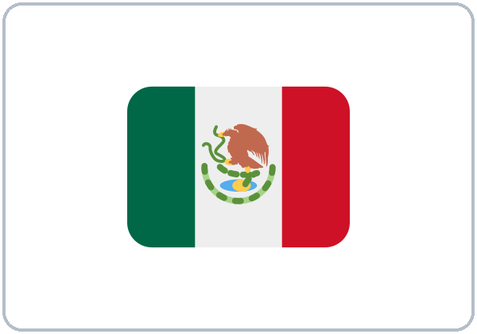 Mexico | 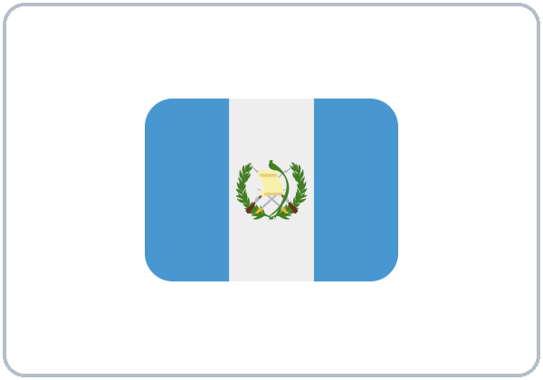 Guatemala | 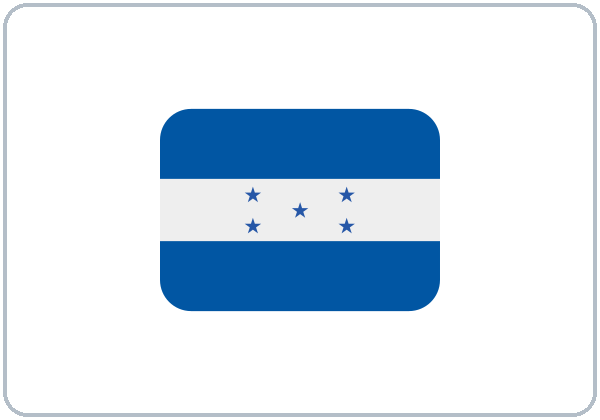 Honduras |
| **3.** Marco's phone number is | ^^555-0186 | ^^555-0168 | ^^555-0196 |
| **4.** Marco is a | 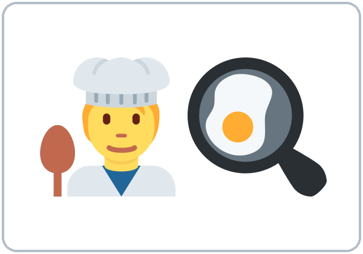 cook | 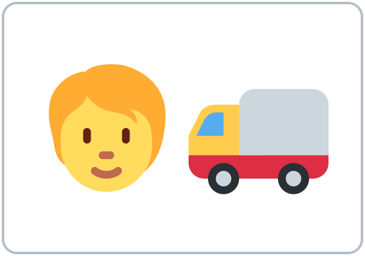 driver |  cashier |
| **5.** Marco has |  1 child | 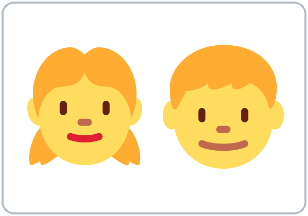 2 kids | 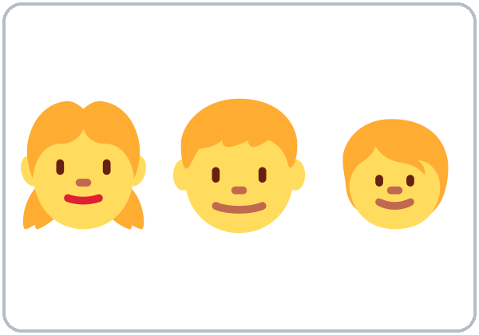 3 kids |
| **6.** English class is on | ^^Monday ^^Wednesday | ^^Tuesday ^^Thursday | ^^Saturday ^^Sunday |
| **7.** English class is at | 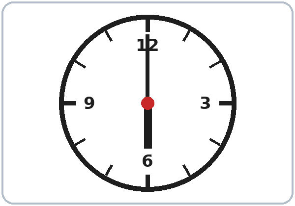 6:00 | 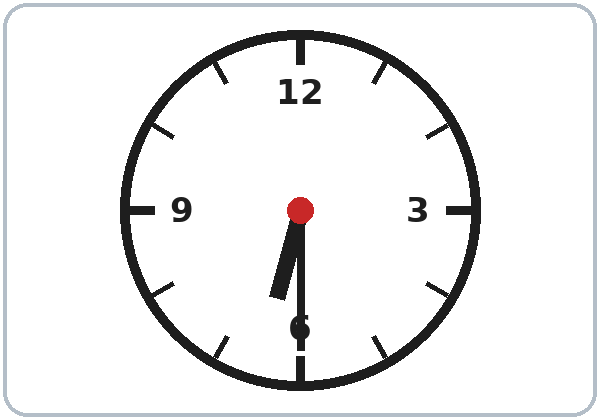 6:30 | 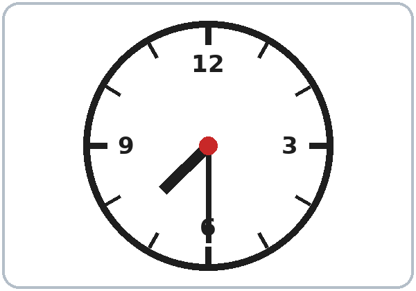 7:30 |
| **8.** How much is the book? Write the number. | ^^$ ______ | | |

### B. Look at the picture. Circle the word.

*Español: Mira el dibujo. Encierra la palabra.*

My language: ______________________________________________

| | | |
|---|---|---|
| 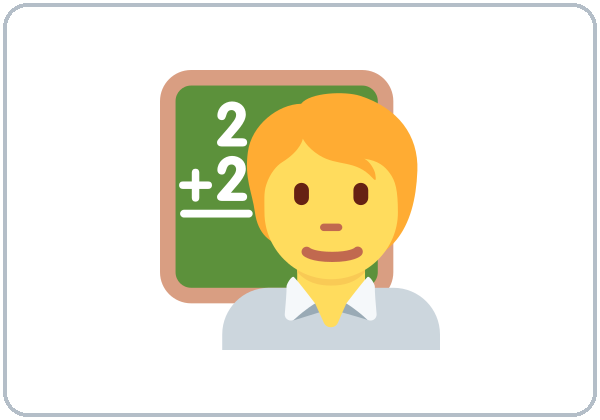 **1.** ^^teacher ^^student | 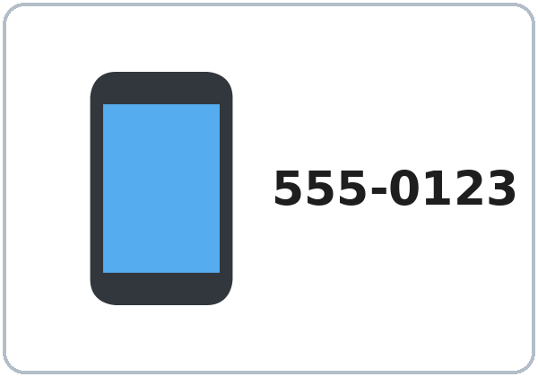 **2.** ^^email ^^phone number | 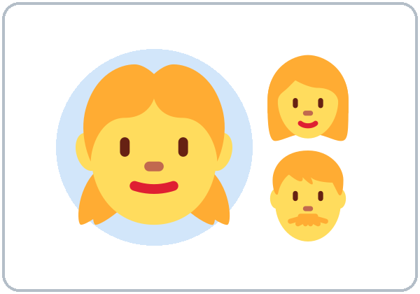 **3.** ^^son ^^daughter |
| 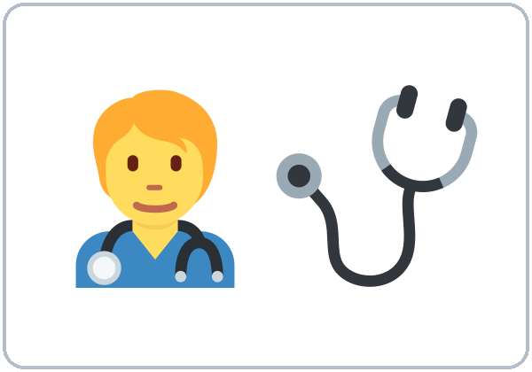 **4.** ^^nurse ^^cook | 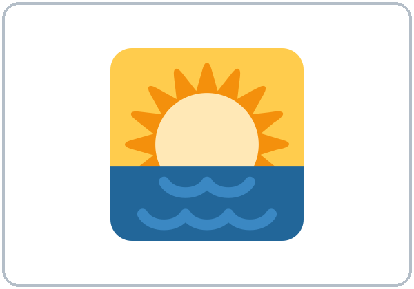 **5.** ^^night ^^morning | 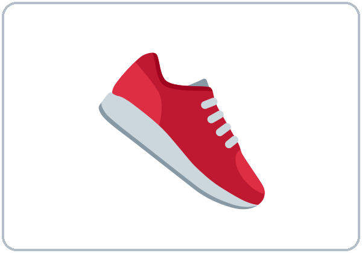 **6.** ^^shoes ^^shirt |

<!-- pagebreak -->

### C. Circle the correct word.

*Español: Encierra la palabra correcta.*

My language: ______________________________________________

1. ____ you from Mexico?        ( **Are**   /   **Is** )

2. She ____ from Honduras.        ( **is**   /   **are** )

3. I'm ____ cook.        ( **a**   /   **an** )

4. I work in ____ office.        ( **a**   /   **an** )

5. This is my sister. ____ name is Ana.        ( **His**   /   **Her** )

6. This is my son. ____ name is Leo.        ( **His**   /   **Her** )

7. How old are you? I ____ 35.        ( **am**   /   **have** )

8. English class is ____ 6:00.        ( **at**   /   **on** )

9. English class is ____ Monday.        ( **at**   /   **on** )

10. How much is ____ shirt?        ( **this**   /   **these** )

11. How much are ____ shoes?        ( **this**   /   **these** )

12. Do you work at night? No, I ____.        ( **don't**   /   **am not** )

<!-- pagebreak -->

## Week 8: Midterm · Form

### D. Look at the practice ID card. Write the information on the form.

*Español: Mira la tarjeta de práctica. Escribe la información en el formulario.*

My language: ______________________________________________

| |
|---|
| 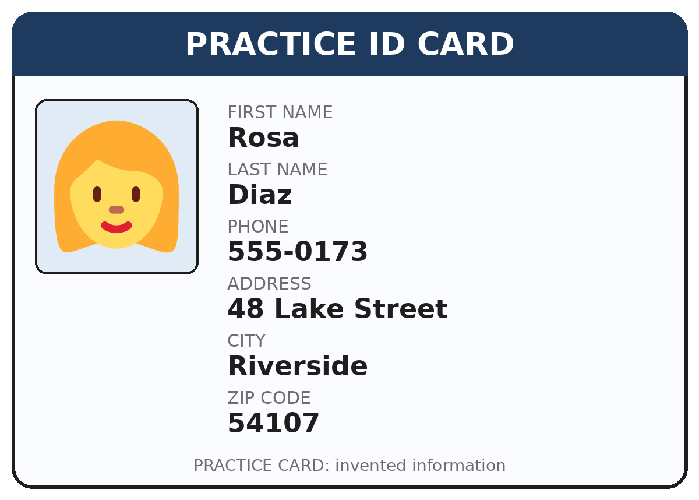 |

| REGISTRATION FORM | (write) |
|---|---|
| **First name** |   |
| **Last name** |   |
| **Phone number** |   |
| **Address** |   |
| **City** |   |
| **ZIP code** |   |

**Score:** A ____ /8   B ____ /6   C ____ /12   D ____ /6   **Total ____ /32**
